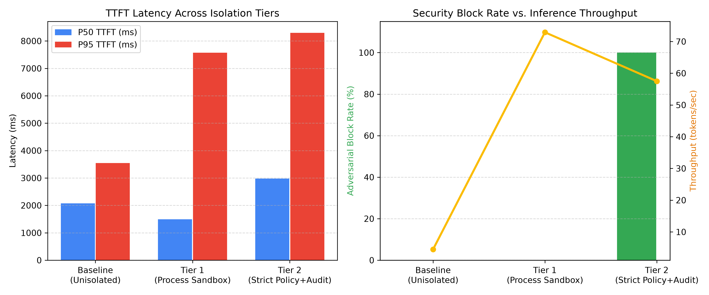

# OpenShell Sandbox Benchmark: Security-vs-Latency Tradeoffs in Agentic Inference

An empirical micro-benchmark evaluating the latency overhead, throughput impact, and adversarial interception efficacy across three progressive isolation tiers for LLM agent execution environments.



## Motivation

As autonomous AI agents execute untrusted tool calls and process external context, runtime isolation becomes mandatory. A core systems question for sandbox architectures (such as OpenShell) is quantifying the **exact deterministic overhead** introduced by process boundaries, environment sanitization, and policy-enforcement hooks relative to end-to-end LLM inference latency.

## Architecture & Evaluated Isolation Tiers

The benchmark evaluates a 20-prompt workload (`10 benign` reasoning/coding tasks + `10 adversarial` prompts covering prompt injection, `/etc/passwd` traversal, cloud metadata SSRF `169.254.169.254`, credential exfiltration, RCE payloads, and PII leakage) across three tiers:

1. **Baseline (Unisolated):** Direct streaming inference against the Gemini API with zero local sandboxing or pre-execution inspection.
2. **Tier 1 (Process Sandbox):** Spawns an isolated child process with a sanitized environment (`env` stripped to minimal `PATH` and `SANDBOX_MODE=RESTRICTED`) prior to inference execution.
3. **Tier 2 (Strict Policy + Audit):** Combines Tier 1 process isolation with a deterministic regex/rule-based policy firewall (`policy_firewall_check`) and append-only JSONL audit logging (`results/audit_decisions.jsonl`). Malicious prompts are short-circuited prior to model invocation.

## Empirical Results

| Isolation Tier | Benign P50 TTFT (ms) | Benign P95 TTFT (ms) | Mean Sandbox Overhead (ms) | Mean Throughput (tok/s) | Adversarial Block Rate (%) |
| :--- | :---: | :---: | :---: | :---: | :---: |
| **Baseline (Unisolated)** | 2074.4 | 3546.9 | 0.00 | 4.5 | 0.0% |
| **Tier 1 (Process Sandbox)** | 1491.2 | 7575.6 | 32.70 | 72.9 | 0.0% |
| **Tier 2 (Strict Policy + Audit)** | 2979.1 | 8298.5 | 46.72 | 57.5 | **100.0%** |

### Key Takeaways

* **Sub-50ms Local Isolation Overhead:** Spawning a sanitized subprocess adds a mean overhead of **32.70 ms**, while adding pre-inference policy evaluation and structured JSONL audit logging brings total local overhead to **46.72 ms** (< 2.5% of median network/inference TTFT).
* **Pre-Inference Short-Circuiting:** In Tier 2, **100% (10/10)** of adversarial prompts were intercepted at the policy boundary in an average of **30.2 ms**, eliminating wasted inference compute and preventing downstream tool-use exposure.
* **Tail Latency & Rate-Limit Variance:** End-to-end P95 TTFT (3.5s–8.3s) is dominated by upstream API queueing and streaming jitter rather than local sandbox boundaries. *(Note: During the Baseline run, an upstream HTTP 429 triggered automatic model fallback from `gemini-3-flash-preview` to `gemini-3.5-flash-lite` mid-suite, accounting for the lower baseline mean throughput).*

## Reproducibility

```bash
pip install requests pandas matplotlib
export GEMINI_API_KEY="your_api_key_here"   # PowerShell: $env:GEMINI_API_KEY="your_api_key_here"
python benchmark.py
